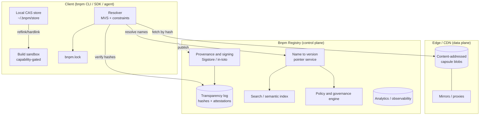
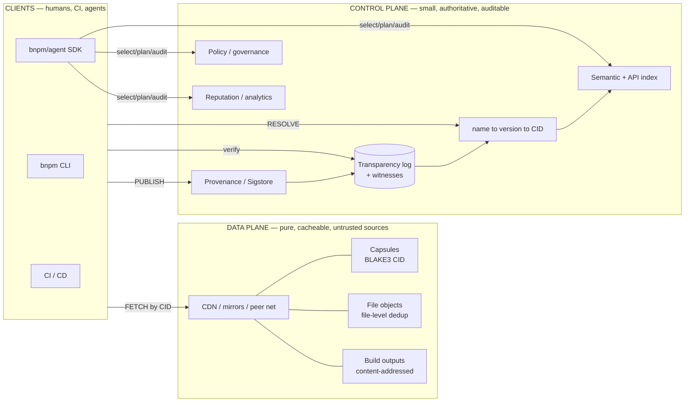

# Bnpm

### A next-generation package ecosystem for JavaScript and the AI era

*A comprehensive technical design*

**Status:** Design proposal / RFC‑0001
**Scope:** Registry, protocol, client, storage, security, and AI‑native platform
**Compatibility target:** The existing npm/JavaScript/TypeScript ecosystem
**Date:** July 2026

---

## 0. How to read this document

This is a full technical design for **Bnpm**, a package management platform intended as a *successor* to npm rather than a faster clone of it. It is organized so that each layer can be read independently:

- **Part I — Why** (§1–§3) analyzes the state of the art and states the theses that justify a clean‑sheet design.
- **Part II — The model** (§4–§11) defines the data plane: content‑addressable storage, the package format, manifest, lockfile, resolver, cache, and wire protocol.
- **Part III — The platform** (§12–§17) defines the registry, security architecture, identity, publishing, CLI, and SDKs.
- **Part IV — AI‑native** (§18–§19) defines the machine‑facing surface that makes agents first‑class users.
- **Part V — Adoption** (§20–§23) covers extensibility, migration, npm compatibility, and a phased rollout, ending with the risks that could sink the project.
- **Appendices** (§A–§F) contain concrete schemas, wire formats, and pseudocode.

A one‑line summary: **Bnpm is a content‑addressed, cryptographically verifiable, ESM‑first package graph with an immutable registry, a capability‑based security model, and a machine‑readable surface designed so that both humans and autonomous agents can select, compose, audit, and upgrade software deterministically.**

---

# Part I — Why a new ecosystem

## 1. What today's package managers got right and wrong

Any credible successor has to begin by respecting the enormous amount that the incumbents got right. npm's flat, decentralized publishing model created the largest software commons in history. The mistakes worth fixing are mostly *original design assumptions* that were reasonable in 2010 and are now load‑bearing liabilities.

### 1.1 The incumbents, honestly assessed

**npm (the CLI + registry).** npm's genius was frictionless publishing: `npm publish` with no gatekeeper produced network effects nothing has matched. But its foundational choices are the source of most modern pain. Package identity is a *mutable name + semver range*, not a fixed artifact, so "the same install" can differ across machines and time. Lifecycle scripts (`preinstall`/`postinstall`) run arbitrary code with full user privileges at install time — the single largest supply‑chain attack surface in the ecosystem. Tarballs are opaque blobs with weak integrity guarantees historically bolted on (`integrity` in the lockfile arrived late). The dependency tree is duplicated per‑project in `node_modules`, wasting enormous disk and I/O. Provenance and signing were absent for a decade and are still opt‑in.

**pnpm.** pnpm is, in the words of one widely‑shared 2025 analysis, *"correct."* Its content‑addressable global store with hardlinks into a strict, symlinked `node_modules` fixes duplication and enforces that code can only import what it declares. This is the single best idea in the current generation and Bnpm adopts its spirit wholesale. pnpm's limits are that it still sits on top of npm's registry, manifest, tarball format, and mutable‑version semantics — it is a superior *client* over an unreformed *substrate*.

**Yarn (Berry) + Plug'n'Play.** Yarn PnP eliminated `node_modules` entirely by shipping a resolver map and serving packages from zips, proving that the `node_modules` convention is not sacred. It also pioneered constraints, workspaces, and offline mirrors. Its cost was ecosystem friction: PnP breaks tools that `fs.stat` their way through `node_modules`, so adoption stalled behind a long tail of compatibility shims.

**Bun.** Bun proved how *fast* installation can be — a native, parallel, syscall‑optimized installer that makes npm feel broken. It demonstrated that performance is a feature users feel on every command. Bun optimizes the existing model rather than changing it; it inherits npm's security and identity model.

**Deno + JSR.** JSR is the most important recent rethink. It is ESM‑only, TypeScript‑native (publish source, transpile server‑side, generate `.d.ts` and docs automatically), immutable (uploads never change or disappear), provenance‑aware (OIDC tokenless publishing from CI), cross‑runtime, and it serves *only the modules you import* rather than whole tarballs. JSR is deliberately "not another package manager" — it is a better *registry* that still federates to npm. Bnpm treats JSR as the closest philosophical ancestor and extends it into a full client+platform.

**Cargo (Rust).** Cargo is the gold standard for developer experience: one manifest (`Cargo.toml`), one lockfile, first‑class workspaces, a build system and package manager unified, features/flags as a first‑class composition mechanism, and a registry (crates.io) with immutable versions (you can *yank* but never mutate or delete). Its resolver is principled. Cargo's lessons: immutability + a unified manifest + workspaces are non‑negotiable. Its limitation for our purposes is that it compiles a closed world; JS must interoperate with a live, dynamic, multi‑runtime ecosystem.

**Go modules.** Go's contributions are profound and under‑appreciated in JS circles: the **minimal version selection (MVS)** algorithm (deterministic, no SAT solver, no lockfile churn), the **module proxy** (`GOPROXY`) as a caching/availability layer, and the **checksum database** (`sumdb`) — a global transparency log that makes every module version's hash publicly auditable and tamper‑evident. Go proved that a *transparency log for package hashes* is practical at ecosystem scale. Bnpm adopts a sumdb‑style log as a core primitive. Go's weakness is ergonomic rigidity (major versions in import paths) that JS should not copy.

**Swift Package Manager.** SwiftPM is git‑URL‑native and integrated with the language toolchain, with a clean manifest‑as‑code model. Its lesson is tight toolchain integration; its weakness is git‑as‑registry, which couples availability and performance to arbitrary hosting.

**Maven / NuGet.** Maven's coordinate system (`groupId:artifactId:version`) and immutable Central releases gave Java two decades of stability; its weakness is XML ceremony and a resolution model ("nearest wins") that surprises people. NuGet brought lockfiles, floating versions, and strong .NET tooling integration, plus a mature signing story. Both show that *namespaced coordinates + immutable releases + signing* scale to enterprise; both are heavier than JS culture will tolerate.

### 1.2 The comparison at a glance

| Capability | npm | pnpm | Yarn PnP | Bun | Cargo | Go mod | JSR | **Bnpm** |
|---|---|---|---|---|---|---|---|---|
| Immutable published versions | partial¹ | partial¹ | partial¹ | partial¹ | ✅ yank‑only | ✅ | ✅ | ✅ **content‑addressed** |
| Content‑addressable store | ❌ | ✅ | ✅ (zips) | partial | ✅ | ✅ | n/a | ✅ **BLAKE3 CAS** |
| Deterministic resolution | lockfile | lockfile | lockfile | lockfile | lockfile | ✅ **MVS** | lockfile | ✅ **MVS + lock** |
| No arbitrary install scripts | ❌ | opt‑in block | ❌ | ❌ | ✅ (build.rs sandboxable) | ✅ | ✅ | ✅ **sandboxed, capability‑gated** |
| Cryptographic provenance | opt‑in | opt‑in | opt‑in | opt‑in | ⚠️ | ✅ sumdb | ✅ | ✅ **mandatory, logged** |
| ESM‑first / TS‑native | ❌ | ❌ | ❌ | ⚠️ | n/a | n/a | ✅ | ✅ |
| Monorepo/workspaces native | ⚠️ | ✅ | ✅ | ✅ | ✅ | ⚠️ | ⚠️ | ✅ |
| Offline‑first | ⚠️ | ✅ | ✅ | ⚠️ | ✅ | ✅ (proxy) | ⚠️ | ✅ |
| Machine/agent‑readable metadata | ❌ | ❌ | ❌ | ❌ | ⚠️ | ⚠️ | partial | ✅ **first‑class** |

¹ *"partial" = the registry discourages but has historically permitted republish/unpublish within windows, and version identity is a mutable name→tarball mapping rather than a content hash.*

### 1.3 The five structural problems Bnpm exists to solve

Cutting through the specifics, the incumbents share five root problems:

1. **Mutable identity.** A package version names a *slot* that a maintainer (or an attacker with their token) can fill with different bytes over time. Everything downstream — caching, reproducibility, trust — is built on sand.
2. **Ambient install‑time code execution.** Lifecycle scripts run with the developer's full privileges before any code is even imported. This is precisely the vector the *Shai‑Hulud* worm used in 2025 to self‑propagate across tens of thousands of repositories: steal the maintainer's token from the environment during a pre/postinstall hook, republish their other packages, repeat. Static scanning cannot stop pre‑install execution.
3. **Per‑project duplication.** The `node_modules` convention copies the same bytes thousands of times across a machine, making installs I/O‑bound and disks full.
4. **Opaque, human‑only metadata.** Package metadata is a loose `package.json` optimized for a 2010 human reading a README. Agents that now write most dependency changes have nothing structured to reason over: no capability declarations, no machine‑readable API surface, no standardized quality or compatibility signals.
5. **Registry as a dumb file server.** npm's registry is fundamentally a blob store with a search box bolted on. Provenance, reputation, policy, license intelligence, and observability are aftermarket products sold by third parties because the substrate exposes none of it.

Bnpm is the design that results from refusing all five.

---

## 2. Vision

> **Bnpm is a verifiable, content‑addressed package graph and a programmable registry, built so that a build is a pure function of a lockfile, code cannot run or reach the network without a declared capability, and every package presents a machine‑readable surface that lets agents and humans select, compose, audit, and upgrade software with equal confidence.**

Three constituencies are first‑class from day one:

- **Humans** get zero‑config, sub‑second, offline‑first workflows with a CLI that does the obvious thing.
- **CI/CD systems** get bit‑for‑bit reproducible builds, hermetic caching, and cryptographic attestations they can gate on.
- **AI agents** get structured metadata, capability declarations, semantic search, machine‑readable docs, and typed tool interfaces so that "add a validated Postgres client with no native deps and a permissive license" is a *query*, not a research project.

The design goal is not "npm with features." It is **the smallest set of primitives that make the above true**, plus a compatibility bridge so the transition costs almost nothing.

---

## 3. Guiding principles

1. **Content addresses everything.** Identity is the BLAKE3 hash of content, not a mutable name. Names are human‑friendly *pointers* into an immutable graph.
2. **Determinism is the default, not a mode.** Given a lockfile, the resolved graph and installed bytes are identical on every machine, forever. Reproducibility is verified, not hoped for.
3. **No ambient authority.** Code gets zero privileges — no filesystem, network, environment, or subprocess — unless a capability is declared in the manifest and granted at install. Install‑time scripts are abolished in favor of sandboxed, declarative build steps.
4. **Verify, don't trust.** Every artifact is signed, every publish is logged to a public transparency log, every install checks provenance against policy.
5. **Simplify by removing.** Prefer deleting a concept over adding a flag. One manifest, one lockfile, one store, one resolution algorithm.
6. **Compatible at the edges, clean at the core.** Speak npm's protocol and consume npm's packages, but store and reason about them in Bnpm's model.
7. **Machine‑readable is co‑equal with human‑readable.** Every artifact a human reads (docs, changelog, metadata) has a structured form an agent can consume, with the same authority.
8. **Fast is correct.** Performance is a first‑class correctness property; a tool developers wait on is a tool they route around.
9. **Offline‑first.** The network is an optimization, not a dependency. The global store is the source of truth locally.
10. **The registry is a platform.** Provenance, policy, reputation, and analytics are protocol‑level primitives, not add‑ons.

---

# Part II — The model

## 4. Architecture overview

Bnpm separates cleanly into a **data plane** (immutable content, addressed by hash, cached everywhere) and a **control plane** (mutable pointers: names, versions, tags, policy, reputation). This is the single most important architectural decision: it lets the heavy bytes be cached, mirrored, and served by anyone, while the small, security‑critical mappings stay authoritative and auditable.



**Key properties that fall out of this split:**

- The data plane is *pure content*: any bit can be fetched from any mirror and verified locally against its hash, so availability and trust are decoupled from any single host. This is Go's module‑proxy insight generalized.
- The control plane is *small and auditable*: the only mutable state is "name X at version Y points to content hash Z," and every such mapping is appended to a public transparency log the moment it is created.
- The client is *authoritative offline*: once the store holds the hashes a lockfile references, no network is required and the result is identical to an online install.

---

## 5. Content-addressable storage and immutable identity

### 5.1 The capsule

The atomic unit of distribution is a **capsule**: an immutable, content‑addressed archive of a single package version's files plus its metadata. A capsule is identified by its **content ID (CID)**:

```
cid = "b3:" || base32( BLAKE3-256( canonical_capsule_bytes ) )
```

BLAKE3 is chosen over SHA‑256 for throughput (it is tree‑structured and SIMD/multicore‑friendly, so hashing multi‑hundred‑MB dependency sets is not a bottleneck) and because its internal Merkle tree lets us **verify arbitrary byte ranges** without downloading the whole capsule — the foundation of the incremental fetch protocol in §11.

A capsule's canonical bytes are deterministic: files are sorted by path, stored with normalized metadata (fixed mtime `0`, fixed permissions by class, no uid/gid), and concatenated in a framed, self‑describing container (§7). Two publishers who publish byte‑identical file trees produce byte‑identical capsules with the *same CID* — enabling global dedup and cross‑publisher reproducibility checks.

### 5.2 Names are pointers, content is truth

```
world:  namespace/name  ──(version pointer)──►  version  ──(fixed)──►  CID  ──►  bytes
        mutable            control plane            immutable            data plane
```

- **`@scope/name`** is a human name owned by an identity.
- **A published version** (`1.4.2`) is an *immutable binding* from that name+version to exactly one CID. Once published, the binding never changes. You may *yank* a version (mark it unfit for new resolutions) but never mutate or remove its bytes — existing lockfiles that pin the CID keep working forever (Cargo's model, enforced by content addressing).
- **Tags** (`latest`, `next`) are mutable pointers to versions, used only for discovery, never baked into a lockfile.

Because the lockfile records CIDs, **the name service can be completely compromised and your build is still safe**: a lockfile references content hashes, and the store verifies bytes against them. An attacker who seizes the registry can deny you *new* resolutions but cannot alter what your lockfile already pins.

### 5.3 The global store

Each machine has one store, `~/.bnpm/store`, laid out by CID:

```
~/.bnpm/store/
  cas/b3/<aa>/<bb>/<cid>.capsule      # immutable capsule blobs (compressed)
  files/b3/<aa>/<bb>/<filehash>       # individual file objects (for granular reuse)
  unpacked/<cid>/                     # materialized trees, ready to link
  index.db                            # local content index (SQLite)
```

Two levels of content addressing give two levels of dedup:

- **Capsule‑level:** identical package versions are stored once per machine regardless of how many projects use them.
- **File‑level:** identical *files* across different packages/versions (e.g., an unchanged file between `1.4.1` and `1.4.2`) are stored once. This makes upgrades near‑free on disk and makes delta transfer trivial (§11).

Materialization into a project uses, in order of preference: **reflink/CoW clone** (APFS, Btrfs, XFS, ReFS) → **hardlink** (pnpm's approach) → **copy**. The project's `node_modules` (or PnP map) contains only links, never bytes. Disk cost of the *N+1*‑th project depending on a package is effectively zero.

---

## 6. Manifest schema

Bnpm uses a single manifest, `bnpm.toml`, chosen as TOML for the same reasons Cargo did: unambiguous, comment‑friendly, diff‑friendly, and hostile to the deep nesting that made `package.json` a dumping ground. `package.json` remains fully supported (§22) and can be auto‑imported.

A deliberately complete example, annotated:

```toml
# ---- Identity -------------------------------------------------------------
[package]
name        = "@acme/http-client"
version     = "2.3.0"
description = "Typed, retrying HTTP client with pluggable transports"
license     = "Apache-2.0"                 # SPDX expression, validated
authors     = ["Acme Eng <eng@acme.dev>"]
repository  = "https://github.com/acme/http-client"
runtime     = ["node>=20", "deno>=2", "bun>=1.2", "workerd"]  # declared support
type        = "module"                     # ESM only; CJS is a compat shim, not a mode

# ---- Entry points (typed, condition-based) --------------------------------
[exports]
"."        = { types = "./dist/index.d.ts", import = "./dist/index.js" }
"./mock"   = { types = "./dist/mock.d.ts",  import = "./dist/mock.js" }

# ---- Dependencies ---------------------------------------------------------
# Ranges express *intent*; the resolver uses MVS (§9). No range = latest compatible.
[dependencies]
"@std/encoding" = "^1.0"
"zod"           = "^3.23"

[dependencies.native-tls]          # a dependency that needs a capability
version    = "^0.4"
grants     = ["net:tls"]           # explicit; install fails if policy forbids

[dev-dependencies]
"vitest" = "^2"

[peer-dependencies]
"typescript" = { version = ">=5.4", optional = true }

# ---- Capabilities: the security contract (§13) ----------------------------
[capabilities]
# What THIS package is allowed to do at runtime. Default = nothing.
net      = ["https://api.acme.dev"]   # egress allowlist, or `false` for none
fs-read  = ["./config"]               # path allowlist
fs-write = false
env      = ["ACME_API_KEY"]           # named env vars only
subprocess = false
# Install/build time is separate and far more restricted (§7.3):
[capabilities.build]
network  = false                      # builds are hermetic by default
scripts  = false                      # no arbitrary lifecycle scripts, ever

# ---- Build (declarative, sandboxed — replaces npm lifecycle scripts) ------
[build]
# A build is a pure function: inputs (source + toolchain) -> outputs (dist).
tool    = "bnpm:tsc"                   # a pinned, sandboxed builder plugin
inputs  = ["src/**", "tsconfig.json"]
outputs = ["dist/**"]

# ---- AI-native surface (§18) ----------------------------------------------
[ai]
summary  = "HTTP client with automatic retries, typed responses, and a mock transport for tests."
intent   = "networking/http-client"    # taxonomy term
capabilities-declared = ["http.request", "http.retry", "http.mock"]
stability = "stable"                    # experimental|stable|maintenance|deprecated
side-effects = "none"                   # none|filesystem|network|global — pure by default
docs     = "./docs/agent.md"            # machine-oriented doc (structured)
tool-interfaces = "./ai/tools.json"     # typed callable surface for agents (§18.4)
examples = "./ai/examples/"             # runnable, verified examples
supersedes = "@acme/legacy-http@^1"     # migration hint for upgrade agents

[workspace]                             # present only in a workspace root
members = ["packages/*", "apps/*"]
```

Design choices worth calling out:

- **Capabilities are in the manifest, not a policy file.** The package *declares* what it needs; the consumer's policy *decides* whether to grant it. A package that starts requesting `net` or `subprocess` in a new version triggers a review gate (§13) — the mechanism that would have stopped Shai‑Hulud cold, because a color‑formatting library suddenly asking for network egress is a diff a human or agent reviews before it runs.
- **`exports` are typed and condition‑based**, and are the *only* way to expose entry points — no deep imports into a package's internals, which kills a whole class of coupling and lets authors refactor freely.
- **The `[ai]` block is not optional metadata folklore** — it is validated on publish and surfaced by the registry's semantic index (§19).

---

## 7. Package format

### 7.1 The capsule container

A capsule is a single framed file: a header, a canonical file table, the file objects, and a detached metadata section.

```
┌───────────────────────────────────────────────────────────┐
│ MAGIC "BNPMCAP1"  | version | flags                        │
├───────────────────────────────────────────────────────────┤
│ MANIFEST  (canonical TOML→CBOR, the resolved manifest)     │
├───────────────────────────────────────────────────────────┤
│ FILE TABLE  (path, mode-class, size, BLAKE3 file-hash)     │  ← sorted by path
│   … one row per file, enabling range fetch & file dedup    │
├───────────────────────────────────────────────────────────┤
│ FILE OBJECTS  (zstd-compressed, concatenated in table ord) │
├───────────────────────────────────────────────────────────┤
│ ATTESTATIONS  (in-toto/SLSA provenance, SBOM, signatures)  │  ← detached, §13
└───────────────────────────────────────────────────────────┘
```

- **Canonical & deterministic:** normalized metadata (fixed timestamps/permissions), sorted entries, `zstd` at a fixed level. The same source tree → the same capsule → the same CID, on any machine. This is what makes cross‑publisher and CI reproducibility *checkable*.
- **Range‑fetchable:** because the file table lists per‑file hashes and offsets and the whole thing sits under a BLAKE3 Merkle tree, a client can fetch and verify *only the files an import graph actually touches* (JSR's "download only what you import," generalized and integrity‑checked).
- **Attestations are detached** so they can be added/rotated (e.g., a new signature, an added SBOM) without changing the content CID of the code itself.

### 7.2 What is published: source, not build output (by default)

Following JSR, the default published artifact is **source** (TypeScript/ESM), with the registry performing deterministic transpilation to generate `.d.ts`, transpiled JS for non‑TS runtimes, and API docs. This eliminates the largest cause of "works on the author's machine": the mystery `dist/` produced by an unpinned local build. When a package genuinely needs a build (native addons, WASM), the build is declarative and hermetic (§7.3), and its outputs are content‑addressed and attested.

### 7.3 Death of the lifecycle script

There is no `preinstall`, `install`, or `postinstall` arbitrary‑code hook. Ever. This single change removes the dominant supply‑chain vector.

Packages that need a build step declare it in `[build]` with:

- a **pinned builder** (`bnpm:tsc`, `bnpm:wasm`, `bnpm:node-gyp`, or a third‑party builder capsule, itself content‑addressed and reputation‑scored),
- explicit **inputs and outputs** (so the build is a cacheable pure function),
- a sandbox with **no network and no ambient filesystem** unless a `[capabilities.build]` grant is present and the consumer's policy allows it.

Build outputs are hashed and can be **shared globally**: if someone on the network already produced the identical output for the identical inputs+toolchain (verified by re‑execution or trusted attestation), your "build" is a cache hit. Native modules stop being a per‑machine compile and become a content‑addressed download with a provenance trail.

---

## 8. Lockfile design

The lockfile, `bnpm.lock`, is the contract that makes a build a pure function. It is:

- **Text, sorted, and merge‑friendly.** Deterministic ordering means near‑zero spurious diffs and trivial conflict resolution (the perennial `package-lock.json` merge nightmare disappears because entries are keyed and sorted, not tree‑positional).
- **Content‑pinned.** Every resolved package records its exact **CID**, not just a version and a legacy `integrity` string. The version is documentation; the CID is truth.
- **Fully closed.** It records the complete resolved graph, the resolver inputs (the manifest ranges that produced it), the registry pointers used, transitive capability grants, and the toolchain identity for any build outputs. Nothing is left to "resolve at install time."
- **Self‑verifying.** It carries a top‑level BLAKE3 digest over its own canonical content, and each entry references the transparency‑log inclusion proof for its publish event (§13), so `bnpm verify` can prove offline that every pinned artifact was legitimately published.

```toml
# bnpm.lock  (excerpt) — generated, do not edit
version = 1
root    = "@acme/app@0.0.0"

[[package]]
name    = "zod"
version = "3.23.8"
cid     = "b3:qm7f…z1"                  # the artifact identity
resolved-from = "^3.23"                 # the range that selected it (MVS)
registry = "bnpm:reg.bnpm.dev"
provenance = { logIndex = 88123441, slsaLevel = 3, publisher = "did:bnpm:zod-org" }
capabilities = {}                        # grants this package received (none)

[[package]]
name    = "native-tls"
version = "0.4.2"
cid     = "b3:pp02…9k"
resolved-from = "^0.4"
provenance = { logIndex = 88110002, slsaLevel = 3, publisher = "did:bnpm:tls" }
capabilities = { net = ["tls"] }         # explicitly granted, recorded here
build   = { tool = "bnpm:node-gyp@2.1.0", outputCid = "b3:aa11…", hermetic = true }

[graph]                                  # adjacency, sorted, for fast + reproducible install
"@acme/app@0.0.0" = ["zod@3.23.8", "native-tls@0.4.2"]
"native-tls@0.4.2" = []
```

Two files, two audiences: `bnpm.toml` states *intent* for humans and agents; `bnpm.lock` states *facts* for machines. Agents that upgrade dependencies edit the manifest's intent and regenerate the lock; they never hand‑edit facts.

---

## 9. Dependency resolution

### 9.1 Algorithm: MVS as the base, SAT only when forced

Bnpm's default resolver is **Minimal Version Selection (MVS)**, adapted from Go. For each module, given the set of version *requirements* transitively induced by the graph, MVS selects the **lowest version that satisfies all requirements** rather than the highest available. The consequences are exactly the properties npm lacks:

- **Deterministic without a solver.** MVS is a graph walk with a per‑module max‑of‑minimums, not a backtracking SAT search. It always terminates, always gives the same answer for the same inputs, and produces *minimal, explainable* diffs ("this upgraded because X now requires ≥1.4").
- **High‑fidelity builds.** You get the versions maintainers actually tested against (their stated minimums), not whatever floated to the top of the range this morning. Upgrades are an explicit act (`bnpm up`), never a silent side effect of an unrelated install.
- **No lockfile churn.** Because selection is a pure function of the manifests in the graph, the lock only changes when a manifest changes.

MVS assumes packages follow **import compatibility** (no breaking changes within a major version). Bnpm can *verify* this rather than assume it: the registry computes the public API surface of each version (it has the types) and flags a minor/patch release that removes or changes an exported signature (§19.3). A version that breaks semver is quarantined from MVS auto‑selection.

**Where SAT is unavoidable** — genuine conflicts, `peerDependencies` that must unify on a single instance (React, the classic case) — Bnpm falls back to a bounded PubGrub‑style solver *scoped to the conflict cluster only*, and reports human/agent‑readable explanations for every decision ("cannot satisfy: A needs react@18, B needs react@17; no single version works"). PubGrub's great virtue is exactly this: excellent error messages instead of "unable to resolve dependency tree."

### 9.2 Multi-version coexistence, safely

For libraries where multiple major versions can coexist (no shared singleton state), Bnpm permits **graph‑local versioning**: different parts of the graph resolve the same name to different versions, materialized as distinct CIDs and wired precisely by the resolver map — pnpm's strict, non‑hoisted linking taken to its logical end. For libraries that *must* be singletons (a peer dep like `react`), the manifest marks them `singleton = true` and the resolver enforces unification or fails loudly with an explanation. This directly fixes npm's "two copies of React" and "phantom dependency" classes of bug.

### 9.3 Complexity and performance

Resolution reads only manifests (tiny CBOR blobs), which are cached content‑addressably like everything else. A cold resolve fetches the manifest DAG (parallel, over one multiplexed connection, §11); a warm resolve is pure local computation over the index and completes in low‑milliseconds even for large graphs. There is no tarball download during resolution — bytes are fetched only after the plan is fixed, and only the bytes the import graph needs.

---

## 10. Caching, offline-first, and the workspace model

### 10.1 Cache hierarchy

```
L0  In-process resolver memo (single command)
L1  ~/.bnpm/store  — machine-global CAS (capsules, files, build outputs, manifests)
L2  Team/CI shared cache — a CAS mirror on the LAN or in the cloud, addressed identically
L3  Edge CDN / mirror — the public data plane
L4  Origin registry — control plane; touched only for new name→version pointers
```

Because every layer is addressed by the *same* content hash, promotion between layers is a verified copy with no re‑indexing, and a cache can be shared across an entire org without trust concerns — you always verify bytes against the hash you asked for. A CI fleet warms L2 once; every subsequent job is an L2 hit and never touches the origin.

### 10.2 Offline-first

The store is the source of truth. `bnpm install` with a lockfile whose CIDs are all present in L1 performs **zero network I/O** and is bit‑identical to an online install. `bnpm` ships an explicit **offline mode** and a **vendoring** command (`bnpm vendor`) that materializes every capsule a lockfile needs into a local directory for air‑gapped or long‑term‑archival builds (Go's vendor directory and Yarn's offline mirror, unified and content‑addressed).

### 10.3 Monorepo / workspace native

Workspaces are not a plugin; they are the default shape. A `[workspace]` root enumerates members; the resolver treats the whole repo as one graph with one lockfile and one store view. Internal packages resolve to each other by content (with a live‑edit "link" mode during development), so a monorepo of 500 packages installs in one pass with perfect cross‑package dedup. Task orchestration (build/test/lint across members, with content‑hash‑based "did anything actually change?" skipping) is built in — the Turborepo/Nx capability, but keyed off the same CAS the installer already uses, so a task whose inputs' hashes are unchanged is never re‑run.

---

## 11. Networking protocol

### 11.1 Transport

The wire protocol, **DPR** (Bnpm Package Registry protocol), runs over **HTTP/3 (QUIC)**. QUIC's multiplexing without head‑of‑line blocking is a natural fit for the access pattern — hundreds of small manifest/metadata requests followed by many parallel content‑range fetches — and its 0‑RTT resumption makes warm reconnects effectively free. The protocol degrades gracefully to HTTP/2 and plain HTTPS for restricted networks and proxies.

### 11.2 Three verbs, content-addressed

DPR is deliberately tiny:

- **`RESOLVE`** (control plane): given `name` + range(s), return the version→CID pointer(s) and their transparency‑log inclusion proofs. Cacheable with short TTL; the only call that must reach an authoritative pointer service.
- **`FETCH`** (data plane): given a CID (and optionally a byte/file subrange), return content. Served by any mirror/CDN; verified locally against the CID, so the source is untrusted by construction.
- **`PUBLISH`** (control plane): submit a capsule + attestations; the registry verifies, assigns/binds the CID, and appends to the transparency log (§16).

### 11.3 Incremental, delta-aware transfer

Because content is addressed at both capsule and file granularity, upgrades transfer only what changed. Upgrading `lib@1.4.1`→`1.4.2` sends only the file objects whose hashes differ; unchanged files are already in the store. For large packages the client requests a **BLAKE3‑verified range set** computed from the file table, so a build that imports 3 modules from a 200‑module package downloads ~3 modules' worth of bytes. This is the practical answer to "the average `node_modules` is enormous": most of it is never fetched.

### 11.4 Availability and censorship-resistance

The data plane's purity means mirrors need no trust and packages cannot silently vanish (the *left‑pad* failure mode). Any party can run a `FETCH` mirror; clients accept bytes from any of them because verification is local. A missing origin degrades to "no *new* resolutions," never "existing builds break." Optionally, popular capsules can be pinned to content‑addressed peer networks (IPFS‑style) for fully decentralized availability, though the default is boring, fast CDNs.

---

# Part III — The platform

## 12. The registry as a programmable platform

The Bnpm Registry is not a file server with search. It is a programmable system whose primitives are exposed by API and extensible by plugins. It is organized as a set of cooperating services over the control‑plane data model.

### 12.1 Services

- **Name & version service.** Owns the mutable `name → version → CID` bindings and tags. Every write is an append to the transparency log. This is the *only* stateful trust root, and it is deliberately small.
- **Transparency log.** A public, append‑only, tamper‑evident Merkle log (a Go‑`sumdb`/Sigstore‑Rekor lineage) recording every publish: the CID, publisher identity, signatures, provenance, and timestamp. Anyone can audit it; clients get inclusion proofs and can detect a forked/lying registry (§13.4).
- **Content service (data plane).** Stores and serves capsules by CID to the CDN/mirrors. Stateless with respect to trust.
- **Provenance & signing service.** Verifies Sigstore/OIDC identities and in‑toto/SLSA attestations at publish; issues and records signatures.
- **Semantic index.** Builds and serves the search/discovery surface — lexical, structural (API shape), and vector/semantic (§19.2). Consumes the `[ai]` block, extracted types, and docs.
- **Security & policy engine.** Runs vulnerability scanning, malware heuristics, license analysis, capability‑diff review, and org policy enforcement (§13, §19).
- **Reputation service.** Computes multi‑signal package and publisher reputation (§19.4).
- **Observability & analytics.** Download/usage telemetry, dependency‑impact analysis, and org dashboards (§19.6).
- **Governance & org service.** Namespaces, teams, roles, policies, and audit (§14, §15).

### 12.2 Everything is an API, and the API is the product

Every registry capability is a documented, versioned API (REST + GraphQL for humans/tools, and a typed SDK; plus a machine surface at `/.well-known/bnpm/` for agents, §18.6). "Show me all packages my org depends on with a copyleft license and a CVE in the last 90 days" is one query. Private/enterprise registries run the same software (self‑hostable, federatable), so an org can operate a fully private control plane while still federating reads to the public data plane and to npm (§22).

### 12.3 Federation

A registry can **federate**: resolve names it doesn't own by delegating to upstreams (public Bnpm, a partner org, or the npm compatibility bridge), while caching results in its own transparency log with a note of provenance. This is how a company runs an internal registry that transparently proxies the public commons yet enforces local policy at the boundary — the "single front door" enterprises want, without a mutable, unauditable mirror.

---

## 13. Security architecture

Security is not a feature bolted to the side; it is the shape of the system. Five layers, defense in depth.

### 13.1 Layer 1 — Immutable, content-addressed identity

Covered in §5, but its security consequence bears restating: **a version is bytes, not a slot.** An attacker who steals a publisher's token cannot alter an already‑published version, cannot make an existing lockfile resolve to different bytes, and cannot silently swap content behind a name. The blast radius of a stolen token is limited to *new* versions, which are gated by the layers below.

### 13.2 Layer 2 — Mandatory provenance and a transparency log

Every publish must carry **provenance**: a Sigstore‑backed signature tied to an OIDC identity (a human via keyless signing, or a CI workload via its OIDC token — GitHub Actions, GitLab, etc.), plus an **in‑toto/SLSA** attestation describing *how* the artifact was built (source repo, commit, builder, inputs). npm made this opt‑in in 2023–2025; Bnpm makes it **mandatory and logged**. Every publish appends to the public transparency log, so:

- Consumers verify, offline, that a pinned CID corresponds to a real, logged publish by the claimed identity (the lockfile carries the inclusion proof).
- A maintainer can detect an unauthorized publish under their name by watching the log (monitors can alert automatically).
- A compromised registry cannot present different histories to different clients without detection (gossip/witness cosigning, §13.4).

### 13.3 Layer 3 — No ambient authority (the capability model)

This is the layer that structurally defeats the Shai‑Hulud class of attack. Two separate sandboxes:

**Install/build time.** There are no arbitrary lifecycle scripts (§7.3). Builds run in a hermetic sandbox with **no network, no ambient filesystem, no environment, no subprocess** unless `[capabilities.build]` explicitly requests them *and* the consumer's policy grants them. A worm cannot execute on install because there is no install‑time execution to hijack; a build that suddenly requests network egress is a reviewable manifest diff, not a silent `curl | sh`.

**Runtime.** Packages declare the capabilities they need (`net`, `fs-read`, `fs-write`, `env`, `subprocess`, each with allowlists). The manifest declares; the consumer's policy disposes. Grants are recorded in the lockfile. On modern runtimes that support permissions (Deno natively; Node via its permission model; workers by construction), Bnpm **enforces** these at runtime by generating the runtime's permission configuration from the granted capability set — so a logging library that declares no network genuinely *cannot* open a socket, even if compromised. Where a runtime can't enforce, Bnpm still uses the declarations for static policy and review gating.

The key insight, learned directly from 2025's worms: **the attack isn't the malicious code, it's the ambient privilege the code inherits.** Remove the ambient privilege and most published‑package attacks have nowhere to land.

### 13.4 Layer 4 — Continuous verification and detection

- **Capability diffing.** When a new version changes its capability requests (adds `net`, `subprocess`, a new egress host), resolution surfaces a **security‑relevant diff** and can be configured to require explicit approval before the version is adopted. This is the single highest‑leverage control: nearly every recent supply‑chain compromise would have produced a glaring capability diff.
- **Automated scanning at publish and continuously.** Static and behavioral analysis, known‑malware signatures, secret scanning, and typosquat/dependency‑confusion detection (name‑similarity + ownership + install‑pattern heuristics — the exact vector behind the 2026 dependency‑confusion campaigns) run on every publish and re‑run as new threat intel arrives, retro‑flagging already‑published versions.
- **Witnessed transparency log.** Independent witnesses cosign the log's checkpoints, so a client can verify it's seeing the same global history everyone else is (defeating split‑view attacks on the control plane).

### 13.5 Layer 5 — Policy as code

Orgs express policy declaratively and the registry + client enforce it uniformly: allowed licenses, minimum SLSA level, required provenance identities, banned packages/publishers, maximum acceptable CVE severity, capability allowlists, "no new maintainer without 2FA," "no version younger than 24h in production" (a cooldown that blunts fast‑moving worms). Policies live in `bnpm.policy.toml`, are versioned, and produce machine‑readable pass/fail with reasons — gate‑able in CI and consumable by agents (§18).

### 13.6 SBOM and license intelligence

Every install can emit a standards‑compliant **SBOM** (SPDX / CycloneDX) directly from the lockfile — it already contains the complete, content‑pinned graph, so the SBOM is exact rather than reconstructed. License analysis resolves the full SPDX expression graph, flags incompatibilities (e.g., a GPL transitive dep in a proprietary app), and tracks license *changes across versions* (a permissive→copyleft relicense is a policy event, not a surprise discovered in an audit).

---

## 14. Identity, authentication, and permissions

### 14.1 Identity

Publishers, orgs, and machines are identified by **decentralized identifiers** (`did:bnpm:…`) bound to one or more authentication methods:

- **Humans:** keyless OIDC (GitHub/GitLab/Google/SSO) via Sigstore, plus hardware‑backed passkeys/WebAuthn. **2FA is mandatory for publishing** — no exceptions, unlike npm's slow, partial rollout.
- **CI/automation:** OIDC workload identity (tokenless publishing from a pipeline, as JSR pioneered) — no long‑lived tokens sitting in CI secrets to be exfiltrated by a worm.
- **Agents (first‑class):** an autonomous agent authenticates as a **scoped machine identity** with an explicit, time‑boxed capability set (e.g., "may open PRs that bump patch versions; may not publish; may read private registry X"), auditable per action (§18.7).

Long‑lived tokens are discouraged and, where used, are **fine‑grained and capability‑scoped** (this package, this action, this expiry) rather than npm's historically coarse, all‑or‑nothing tokens.

### 14.2 Permission model

A capability‑based ACL over three axes — *who* (identity/team/agent), *may do what* (read, resolve, publish, yank, tag, admin, delegate), *on what scope* (namespace, package, version‑channel). Roles are sugar over capability sets. Every grant is auditable and every action is logged. Delegation is explicit and revocable, so an agent or CI system holds exactly the authority it needs for exactly as long as it needs it.

---

## 15. Publishing workflow

Publishing is designed to be **one command for the common case and provably safe for the paranoid case.**

```
$ bnpm publish
```

Under the hood:

1. **Build (if any)** runs hermetically; outputs are content‑addressed.
2. **Canonicalize** the file tree into a capsule; compute its CID.
3. **Verify semver honesty**: the registry (or a local dry‑run) diffs the public API surface vs. the previous version and refuses a patch/minor that breaks compatibility unless the author overrides with an explicit acknowledgment (this makes MVS trustworthy, §9.1).
4. **Attest**: sign with the OIDC/keyless identity; attach the SLSA provenance and SBOM.
5. **Publish**: submit to the name service, which binds `name@version → CID`, appends to the transparency log, and returns the inclusion proof.
6. **Immutable thereafter**: the version can be *yanked* (excluded from new MVS selection, with a reason) but never mutated or deleted. `latest`/channel tags can move.

Guardrails, on by default: a **publish cooldown** before a version is eligible for `latest`, **provenance required**, **2FA required**, **capability‑diff summary** shown to the publisher, and **release channels** (`stable`/`next`/`canary`) so pre‑release code is discoverable without polluting `latest`. Organizations can require review approvals, signed commits, or a passing policy check as publish preconditions.

---

## 16. Client / CLI

The CLI is a single fast native binary (`bnpm`), designed so the common commands are obvious and the advanced ones compose.

```
bnpm init                 # scaffold bnpm.toml (imports package.json if present)
bnpm add zod              # add a dep by intent; updates manifest + lock, installs
bnpm add zod --why        # explain what will be selected and why (MVS trace)
bnpm install | bnpm i      # materialize the locked graph (offline if store is warm)
bnpm up [pkg]              # deliberate upgrade: raise minimums, show minimal diff
bnpm remove zod
bnpm run <task>           # run workspace tasks with content-hash-based skipping
bnpm why zod              # full provenance: who published, when, log index, path in graph
bnpm audit                # vulns, license conflicts, capability diffs, policy result
bnpm verify               # prove every locked CID is legitimately published (offline)
bnpm vendor               # materialize all capsules for air-gapped builds
bnpm publish              # §15
bnpm search "retrying http client, no native deps, permissive license"  # semantic (§19.2)
bnpm policy check         # evaluate bnpm.policy.toml against the graph
bnpm agent <subcommand>   # machine-facing surface (§18)
```

Design commitments: **zero‑config** (sensible defaults; a bare `bnpm install` in an npm project just works via the compat bridge), **fast** (native, parallel, QUIC, warm‑cache installs in the tens of milliseconds), **explainable** (`--why` on everything; the resolver can always justify a choice — a direct answer to npm's inscrutable resolution errors), and **honest output** (structured `--json` on every command so tools and agents parse rather than scrape).

---

## 17. SDKs and programmatic API

Everything the CLI does is available as a typed library, because agents and build tools should not shell out and parse text.

- **`@better-npm/core`** — resolver, store, capsule read/write, lockfile, verification. Pure, embeddable, runtime‑agnostic (Node/Deno/Bun/workers/WASM).
- **`@better-npm/registry`** — typed client for RESOLVE/FETCH/PUBLISH, search, provenance, policy.
- **`@better-npm/sbom`** — SBOM/license extraction from a lockfile.
- **`@better-npm/agent`** — the AI‑native SDK (§18): capability queries, semantic search, upgrade planning, audit, and a safe "apply" that edits manifests and regenerates locks transactionally.

The programmatic API is the substrate the CLI itself is built on (dogfooded), which guarantees parity: anything a human can do at the terminal, an agent can do through a typed, auditable call.

---

# Part IV — AI-native

## 18. Designing for agents as first-class users

Today, a large and growing share of dependency changes are authored by coding assistants and autonomous agents, and CI systems apply them unattended. Yet package metadata is still optimized for a human skimming a README. The result is that agents *guess*: they infer a package's purpose from its name, its API from scraping types, its safety from download counts. Bnpm's thesis is that **the ecosystem should present a structured surface that lets an agent reason instead of guess** — and that doing so also makes the human experience better, because the same structure powers real search, real audits, and real upgrade explanations.

Crucially, none of this is a separate "AI product." It is the *same* immutable, verifiable graph, exposed with machine‑readable projections. An agent's actions are as auditable and reproducible as a human's because they operate on the same lockfile, transparency log, and capability model.

### 18.1 Structured, machine-readable metadata

The `[ai]` manifest block (§6) is validated on publish and indexed. It provides an agent, without executing or scraping anything:

- **`intent`** — a term from a curated capability taxonomy (`networking/http-client`, `data/orm/postgres`, `crypto/hashing`), so "find me an X" is a filter, not a fuzzy search.
- **`capabilities-declared`** — the functional capabilities the package *offers* (distinct from the security capabilities it *requests*).
- **`side-effects`** — `none | filesystem | network | global`, letting an agent prefer pure libraries and reason about test isolation.
- **`stability`** and **compatibility guarantees** — machine‑readable lifecycle stage and semver posture.
- **`supersedes` / `deprecated-in-favor-of`** — explicit migration edges so an upgrade agent can plan a path off an abandoned library.

### 18.2 Extracted API surface (the registry knows your types)

Because packages publish source and the registry has the TypeScript, it computes and serves a **structured description of every export**: signatures, parameter and return types, type‑level docs, and a normalized "shape." This gives agents (and humans, and the search index) a canonical, machine‑consumable API model per version — and enables **API‑diffing across versions** (§9.1, §19.3) so an agent can answer "will upgrading break my call sites?" by comparing the shape it uses against the shape the new version exposes, *before* installing.

### 18.3 Machine-readable documentation and verified examples

Docs are published in a structured form (`./docs/agent.md` plus generated API docs) and, more importantly, **examples are runnable and verified**. The registry executes each declared example in a sandbox against the actual package version and records pass/fail. An agent choosing a library gets *examples that are known to work with the version it's about to install*, not stale snippets — a large reduction in the "the AI used an API that doesn't exist" failure mode, because the grounding is version‑exact and machine‑checked.

### 18.4 Tool interfaces: packages as callable capabilities

A package may expose a **typed tool interface** (`./ai/tools.json`) describing callable operations in a schema agents already understand (JSON‑Schema / MCP‑compatible tool definitions). This lets an agent discover not just "this is an HTTP client" but "here is the `request(spec) → Response` operation with this input/output schema and these side effects." The registry indexes these, so an agent can query the *capability space* directly ("what packages expose a `sendEmail`‑shaped tool with no filesystem side effects?") and compose software from typed building blocks. This is the bridge between the package ecosystem and the emerging MCP/agent‑tooling world: a Bnpm package can *be* a set of well‑described tools, discoverable in the same registry, with the same provenance and reputation guarantees.

### 18.5 Quality and trust signals, as data

Every signal an agent needs to make a safe choice is a first‑class, queryable field rather than a vibe: provenance (SLSA level, publisher identity, log index), reputation (§19.4), maintenance signals (release cadence, responsiveness, bus‑factor), security posture (open CVEs, capability footprint, whether it requests `subprocess`/`net`), popularity *with context* (downloads, but weighted by verified production use, not raw counts that typosquatters game), and compatibility (verified semver honesty, runtime support matrix, API‑diff cleanliness). An agent's selection policy becomes an explicit, inspectable query over these fields — and so does a human's, via `bnpm search`.

### 18.6 The agent-facing endpoints

The registry exposes a stable machine surface under `/.well-known/bnpm/` and via `@better-npm/agent`:

- **`select`** — "give me candidates matching this intent + constraints (license, side‑effects, no native deps, min SLSA, runtime), ranked, with rationale."
- **`explain`** — "why is package P in my graph, who published it, what does it request, what changed since the version I have."
- **`plan-upgrade`** — "compute a minimal, safe upgrade set for goal G (patch security fixes / move to v2 of X), with the API‑diff impact on my code and the capability diffs I'd be accepting."
- **`audit`** — "return the machine‑readable security/license/policy state of this graph."
- **`compose`** — "given these typed tool needs, propose a set of packages that satisfy them."

Each returns typed, cited results (every claim links to the transparency log / provenance record), so an agent's reasoning is grounded and an operator can audit exactly *why* the agent chose what it did.

### 18.7 Safe autonomy: agents act within the same guardrails

Agent authority is scoped and auditable (§14.1). An agent can be granted, e.g., "propose dependency upgrades as PRs, subject to `bnpm.policy.toml`, may not publish, may not grant new capabilities without human approval." Because every mutation flows through the manifest→lock→verify pipeline, an agent that upgrades a dependency produces a diff a human (or a reviewing agent) can inspect, a lock that `bnpm verify` proves is legitimate, and a capability diff that surfaces any new privilege the change would introduce. **Autonomy is bounded by the same capability and provenance model that protects humans** — an agent cannot, for instance, silently accept a package that newly requests `subprocess`, because that requires a grant the agent doesn't hold.

### 18.8 Generation and provenance of AI-authored packages

When agents *publish* (not just consume), the provenance chain records it: the machine identity, the model/tooling attestation, and the human or policy that authorized it. This keeps the commons auditable as the share of machine‑authored code rises — you can always answer "what produced this artifact, under whose authority, from what source."

---

# Part V — Adoption

## 19. Registry platform capabilities (detailed)

This section expands the registry's higher‑order features — the things that make it a platform rather than a bucket.

### 19.1 Provenance and reputation as infrastructure

Covered in §13; the platform point is that these are **queryable primitives**. "List my dependencies whose publisher identity changed in the last release" or "block any dependency below SLSA 3" are one‑liners, not bespoke security tooling.

### 19.2 Discoverability and semantic search

Search operates on three indexes over the same corpus: **lexical** (names, keywords), **structural** (API shape and tool interfaces — "packages exposing a function returning `Stream<T>`"), and **semantic** (vector embeddings of docs, `[ai].summary`, and intent). A query like *"a retrying HTTP client, ESM, no native deps, permissive license, actively maintained"* resolves against all three plus the policy/quality filters, ranked with explainable scoring. Same endpoint serves humans (`bnpm search`) and agents (`select`).

### 19.3 Dependency and API visualization

The registry serves the full dependency graph and API‑surface data, so tooling can render dependency graphs, blast‑radius analyses ("if CVE‑X hits `lib`, which of my services are affected and how deep"), and version‑to‑version **API diffs**. Because the data is exact (from the lockfile and extracted types), these are precise, not heuristic.

### 19.4 Reputation scoring

A transparent, multi‑signal score — provenance strength, maintenance cadence, security history, semver honesty (measured, via API diffs), adoption in *verified production* graphs, and independent audits — with every input inspectable. Deliberately resistant to the metrics typosquatters and worms game (raw download counts, star counts), because it weights *verified* signals over spoofable ones.

### 19.5 Governance, orgs, and policy

Namespaces map to orgs; teams and roles map to the capability ACL (§14). Org‑level policy (§13.5) is enforced at the registry boundary and in the client. Full audit logs of every publish, grant, yank, and policy decision. Enterprises get the single‑front‑door federated registry (§12.3) with local policy and private packages, federating reads to the public commons.

### 19.6 Observability and analytics

Because installs resolve through the control plane and (optionally) report anonymized, policy‑gated telemetry, the platform can offer dependency‑health dashboards, upgrade‑lag tracking, vulnerability exposure over time, and "you depend on this abandoned package transitively" alerts — org‑scoped, privacy‑respecting, and opt‑in.

### 19.7 Extensibility

The platform is extensible without forking it:

- **Registry plugins** (server side): custom scanners, policy evaluators, reputation signals, or federation adapters, run in a sandbox with declared capabilities (the same model as packages).
- **Client plugins / builders**: content‑addressed, capability‑gated builder capsules (§7.3) and CLI extensions.
- **Webhooks and a typed event stream** for every registry event (publish, yank, policy violation, new CVE match) so orgs can wire the registry into their own systems.
- **A stable public API** (REST/GraphQL/SDK/agent endpoints) as the universal extension surface — the registry is programmable by design.

---

## 20. Migration and npm compatibility

A superior design that requires a flag day is a research project, not a successor. Bnpm is built to be adopted **incrementally, per‑project, with an escape hatch at every step.**

### 20.1 Consume the npm ecosystem transparently

- **The compat bridge** lets Bnpm resolve and install npm packages directly. On first encounter it fetches the npm tarball, **canonicalizes it into a capsule** (deterministic normalization → a stable CID), records it in the transparency log with a "sourced from npm" provenance note, and thereafter treats it as any other content‑addressed artifact. The npm registry becomes just another federated upstream (§12.3).
- **`package.json` is a first‑class input.** `bnpm init` imports it; Bnpm can operate a project with no `bnpm.toml` at all, reading `package.json` + generating `bnpm.lock`. Teams adopt Bnpm as *just a faster, safer installer* with zero manifest changes, then opt into native features when ready.
- **`node_modules` compatibility mode.** For tools that expect a real `node_modules`, Bnpm materializes a correct (strict, non‑hoisted, link‑based) tree — pnpm‑style — so the entire existing toolchain works unmodified. PnP‑style `node_modules`‑free mode is available for those who want it, but it is opt‑in, learning from Yarn PnP's adoption friction.

### 20.2 Publish to both worlds

`bnpm publish` can **dual‑publish**: emit the native capsule to the Bnpm registry *and* a compatible tarball to npm, so a maintainer reaches Bnpm users and the entire installed base of npm users from one command. Early adopters lose no audience.

### 20.3 Wrapping legacy risk

Packages that still contain lifecycle scripts (imported via the bridge) don't get to run them ambiently. Bnpm quarantines them: either the script is unnecessary (most are, or can be replaced by a declarative build) and is dropped, or it is run in the hermetic build sandbox with no capabilities unless explicitly granted and policy‑approved — so importing the legacy ecosystem doesn't import its ambient‑execution risk.

### 20.4 Migration path, staged

1. **Drop‑in installer.** Use `bnpm install` on an unmodified npm project. Win: speed, dedup, offline, a real lockfile, and audit/provenance over your existing deps.
2. **Adopt the manifest.** Import to `bnpm.toml`; gain capabilities, typed exports, the `[ai]` surface.
3. **Turn on policy.** Enforce provenance, licenses, capability review, cooldowns in CI.
4. **Native publish.** Dual‑publish, then Bnpm‑native as the ecosystem crosses over.
5. **Drop the bridge.** For greenfield or fully‑migrated graphs, run pure Bnpm — no npm, no `node_modules`, no scripts.

Each step delivers value on its own; none requires the next.

---

## 21. What we deliberately remove

Simplicity here means *fewer concepts*, not fewer features. Bnpm removes:

- **Lifecycle scripts** (`pre/post*install`) — replaced by declarative, sandboxed builds. *(Removes the dominant attack vector.)*
- **Mutable versions / unpublish windows** — replaced by immutable content + yank. *(Removes a whole class of reproducibility and trust bugs.)*
- **Hoisting and phantom dependencies** — replaced by strict, content‑addressed linking. *(Removes "works because of a sibling's dep" fragility.)*
- **Per‑project `node_modules` duplication** — replaced by the global CAS with links. *(Removes the disk/I/O tax.)*
- **The build‑output‑as‑publish‑artifact guessing game** — replaced by publish‑source + deterministic server transpile. *(Removes "works on my machine" dist mysteries.)*
- **Ambient, coarse tokens** — replaced by OIDC/keyless + fine‑grained, scoped, expiring grants. *(Removes the exfiltratable long‑lived secret.)*
- **Deep imports into package internals** — replaced by typed `exports` as the only surface. *(Removes accidental coupling.)*
- **Lockfile merge hell** — replaced by a sorted, keyed, deterministic lock. *(Removes a daily papercut.)*
- **SAT‑solver nondeterminism as the default** — replaced by MVS, with SAT only for real conflicts. *(Removes surprise upgrades and churny locks.)*

Every removal is also a feature: less surface to attack, less state to get wrong, less for a human or an agent to reason about.

---

## 22. Reference architecture summary



The whole system is this picture: **untrusted bytes verified against a small, auditable pointer‑and‑proof layer, consumed identically by humans, CI, and agents.**

---

## 23. Risks, open questions, and honest limitations

A design document that only lists strengths is marketing. The real obstacles:

- **Ecosystem gravity.** npm's network effect is the deepest moat in software. Bnpm's answer is to be a *strictly better npm client first* (§20.1) so adoption costs nothing, and to earn the native surface later. This is a bet on gradualism; it could still stall in the "good enough" trough that Yarn PnP hit.
- **Runtime enforcement is uneven.** Capability enforcement at runtime is strong on Deno and workers, partial on Node, absent on old runtimes. Where enforcement is unavailable, capabilities degrade to *static policy + review gating* — still valuable (it stopped the worm at install), but not a runtime guarantee everywhere. This is a real, honest gap that closes as runtimes adopt permission models.
- **MVS vs. ecosystem habits.** MVS is unfamiliar to JS developers used to "latest wins." The semver‑honesty verification (§9.1) is what makes it safe, but it depends on the registry's API‑diffing being accurate for dynamic, type‑fluid JS. Edge cases (types that lie, runtime behavior not captured by signatures) remain.
- **Publish‑source transpilation** must be deterministic across a sprawling matrix of runtimes and TS versions; getting bit‑reproducibility here is genuine engineering, not a given.
- **Governance of the transparency log and reputation** is a socio‑technical problem, not just a cryptographic one — who witnesses, who curates the intent taxonomy, how reputation resists Sybil and manipulation at scale.
- **Agent‑authored publishing at scale** could flood the commons; reputation, provenance, and cooldowns are the intended dampers, but their calibration is unproven.
- **Migration of native modules** (node‑gyp, prebuilt binaries) into hermetic, content‑addressed builds is the hardest long‑tail compatibility work.

None of these is fatal, but each is where the project would actually be won or lost. The design's central wager is that **content addressing + capabilities + a transparency log + a machine‑readable surface** are the right four primitives, and that everything else is implementation.

---

# Appendices

## Appendix A — Example `bnpm.toml` (application, with workspace)

```toml
[package]
name    = "@acme/web"
version = "0.0.0"
private = true
type    = "module"
runtime = ["node>=22", "deno>=2"]

[dependencies]
"@acme/http-client" = "^2.3"
"zod"               = "^3.23"
"react"             = { version = "^19", singleton = true }

[dev-dependencies]
"vitest"     = "^2"
"typescript" = "^5.6"

[capabilities]                 # the app's own runtime capabilities
net        = ["https://api.acme.dev", "https://cdn.acme.dev"]
fs-read    = ["./public", "./config"]
fs-write   = ["./.cache"]
env        = ["NODE_ENV", "ACME_API_KEY"]
subprocess = false

[policy]                       # inline policy (or reference bnpm.policy.toml)
min-slsa-level      = 3
allow-licenses      = ["MIT", "Apache-2.0", "BSD-3-Clause", "ISC"]
require-provenance  = true
max-cve-severity    = "medium"
version-cooldown    = "24h"
review-capability-diffs = true

[workspace]
members = ["packages/*", "apps/*"]

[ai]
summary = "Acme customer-facing web app."
intent  = "app/web-frontend"
side-effects = "network"
```

## Appendix B — `bnpm.lock` grammar (informative)

```
lockfile   := header package* graph
header      := "version" int  "root" pkgref  "lockDigest" b3hash
package     := "[[package]]"
               name version cid resolvedFrom registry provenance
               capabilities? build?
provenance  := logIndex slsaLevel publisherDID inclusionProof
build       := tool outputCid hermeticBool
graph       := "[graph]" (pkgref "=" pkgref-list)*
```

Every field is content‑derived or an immutable pointer; regenerating the lock from unchanged manifests yields a byte‑identical file (deterministic ordering + canonical encoding).

## Appendix C — Resolution algorithm (MVS core, pseudocode)

```
resolve(rootManifest):
    # requirements: module -> highest of the minimum versions demanded anywhere in the graph
    reqs = {}
    worklist = [rootManifest]
    while worklist:
        m = worklist.pop()
        for (dep, range) in m.dependencies:
            minV = lowestVersionSatisfying(range)          # MVS: the stated minimum
            if dep not in reqs or minV > reqs[dep]:
                if reqs.get(dep) and majorDiffers(minV, reqs[dep]) and isSingleton(dep):
                    raise ConflictExplained(dep, reqs[dep], minV)   # -> bounded PubGrub
                reqs[dep] = max(reqs.get(dep, minV), minV)
                worklist.push(fetchManifest(dep, reqs[dep]))         # tiny CBOR, cached by CID
    # non-singletons may coexist at multiple versions (graph-local); singletons must unify
    graph = buildGraph(reqs)                                          # verify semver-honesty per edge
    return pinToCIDs(graph)                                           # names -> immutable content
```

Properties: deterministic, terminating, minimal‑diff, and fully explainable (each `reqs[dep]` records the edge that set it). SAT/PubGrub is entered *only* on a raised `ConflictExplained`, scoped to the conflicting cluster.

## Appendix D — DPR wire protocol (informative)

```
# Control plane (authoritative, short-TTL cacheable)
RESOLVE  { name, ranges[], registry }
      -> { bindings: [{ version, cid, logIndex, inclusionProof, provenance }] }

# Data plane (any mirror; verified locally against the CID)
FETCH    { cid, ranges?: [{ fileOrByteRange }] }
      -> { bytes, merkleProof }        # BLAKE3 range proof; source is untrusted

# Control plane (mutating; appends to transparency log)
PUBLISH  { capsule, attestations[], signature, identity(OIDC) }
      -> { cid, version, logIndex, inclusionProof }
```

Transport: HTTP/3 (QUIC), fallback HTTP/2 → HTTPS. All content responses are self‑verifying; only RESOLVE/PUBLISH require a trusted control‑plane endpoint, and their results are auditable against the witnessed transparency log.

## Appendix E — Agent API sketch (`@better-npm/agent`)

```ts
const bnpm = createAgentClient({ registry, identity /* scoped, time-boxed */ });

// Select by intent + hard constraints; results are ranked and cited.
const candidates = await bnpm.select({
  intent: "networking/http-client",
  constraints: { license: ["MIT","Apache-2.0"], sideEffects: "none",
                 nativeDeps: false, minSlsa: 3, runtime: "node>=22" },
});

// Plan a safe upgrade; get API-diff impact and capability diffs BEFORE applying.
const plan = await bnpm.planUpgrade({ goal: "security-patches" });
//   -> { changes:[{pkg, from, to, apiDiff, capabilityDiff, breaking:false}], ... }

// Apply transactionally: edits bnpm.toml, regenerates bnpm.lock, verifies.
await bnpm.apply(plan, { policy: "./bnpm.policy.toml" }); // refuses if policy fails

// Everything is auditable: each result links to the transparency log + provenance.
```

## Appendix F — Mapping Bnpm's decisions to their intellectual sources

| Bnpm decision | Borrowed / adapted from | Improved by |
|---|---|---|
| Content‑addressed store + hardlink/reflink | pnpm, Nix | file‑level dedup, BLAKE3 range fetch |
| Immutable versions (yank, never mutate) | Cargo/crates.io, Go, JSR | content addressing makes it structural |
| Minimal Version Selection | Go modules | + verified semver honesty, PubGrub fallback |
| Transparency log for hashes | Go `sumdb`, Sigstore Rekor | witnessed, carries provenance + capability diffs |
| Keyless/OIDC provenance | Sigstore, npm provenance, JSR | mandatory + logged, not opt‑in |
| Publish source, transpile server‑side | JSR/Deno | + hermetic builds for the native long tail |
| `node_modules`‑free option | Yarn PnP | opt‑in, with strict‑link default for compat |
| Native, parallel, fast installer | Bun | over a content‑addressed, verified substrate |
| Unified manifest + workspaces + tasks | Cargo, Turborepo/Nx | keyed off the same CAS as installs |
| Capability/permission model | Deno, capability security research | applied to *packages* and *builds*, policy‑gated |
| Machine‑readable tool interfaces | MCP / agent tooling | unified with package provenance & reputation |

---

*End of design. Bnpm is a proposal: the argument is that the next decade's default JavaScript distribution system will be content‑addressed, verifiable, capability‑secured, and machine‑legible — and that the cost of getting there can be made nearly zero by being a better npm client on the way to being a better ecosystem.*
