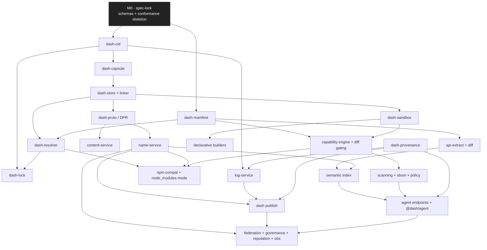

# Dash — Agentic Implementation & Build Plan

**Normative source:** [`../docs/DESIGN.md`](../docs/DESIGN.md) · **Phasing:** [`ROADMAP.md`](ROADMAP.md) · **Execution model:** [`AGENT-PLAYBOOK.md`](AGENT-PLAYBOOK.md) · **Tasks:** [`TASK-BACKLOG.md`](TASK-BACKLOG.md)

This is the core build plan: **what** gets built, in **what order**, by **which workstream**, gated by **which acceptance criteria**, and how the work is **decomposed so a fleet of agents can build it in parallel** without stepping on each other.

## How to use this document

- **Humans** read §1–§3 to understand the shape of the system and the plan of attack.
- **Orchestrating agents** read §4 (workstreams), §5 (the DAG), and §6 (parallelization) to schedule work, then pull concrete units from [TASK-BACKLOG.md](TASK-BACKLOG.md).
- **Implementing agents** are handed a single task (from the backlog) whose `component` points to a §4 workstream and whose acceptance criteria are the local Definition of Done.

---

## 1. First principles of the build

The architecture (DESIGN §4) already tells us how to build it: the system is two planes — a **pure, content‑addressed data plane** and a **small, authoritative control plane** — consumed by three clients (humans, CI, agents). That split is also the *build* strategy:

1. **Build the data plane first, entirely offline.** Content addressing has no external dependencies; it is pure functions over bytes. It can be built, tested, and proven reproducible before any network or registry exists. This front‑loads the hardest correctness property (determinism) into the phase with the fewest moving parts.
2. **Layer the resolver on top of local content.** Resolution reads manifests (tiny blobs) and produces a lock; it needs a *content source*, not a *registry*. A fixture/bridge source suffices, so the resolver is proven before the registry.
3. **Then stand up the control plane.** Names, the transparency log, provenance — the security‑critical, stateful minority — built against a proven data plane.
4. **Then remove ambient authority.** Capabilities/hermetic builds/scanning are a security *layer over* a working install, added once the happy path is deterministic.
5. **Then bridge to npm and open the AI surface.** Ecosystem compatibility and the agent endpoints are *projections* of the now‑complete core.
6. **Then platformize and harden.** Federation, governance, reputation, SLOs.

The invariant: **each layer is provable before the next is started, and "provable" means a conformance suite, not a demo.**

## 2. Module map → build order

```
                 ┌─────────────────────────────────────────────┐
   DATA PLANE →  │ blake3-cid → capsule → store → linker        │  (M1)
                 └───────────────┬─────────────────────────────┘
                                 ▼
   RESOLVE    →  │ manifest ⋅ lockfile ⋅ resolver(MVS+PubGrub) ⋅ │  (M2)
                 │ semver-honesty ⋅ workspace                    │
                                 ▼
   CONTROL    →  │ name-svc ⋅ transparency-log ⋅ provenance ⋅    │  (M3)
                 │ content-svc ⋅ DPR transport ⋅ publish         │
                                 ▼
   SECURITY   →  │ sandbox ⋅ builders ⋅ capability-engine ⋅      │  (M4)
                 │ scanning ⋅ sbom ⋅ policy                      │
                                 ▼
   BRIDGE     →  │ npm-compat ⋅ node_modules-mode ⋅ dual-publish │  (M5)
                                 ▼
   AI-NATIVE  →  │ api-extract ⋅ examples-runner ⋅ tool-index ⋅  │  (M6)
                 │ semantic-index ⋅ agent-endpoints ⋅ @dash/agent│
                                 ▼
   PLATFORM   →  │ federation ⋅ governance ⋅ reputation ⋅ obs    │  (M7)
```

## 3. Repository & component boundaries

A monorepo (dogfooding Dash workspaces once M2 lands). Component boundaries are drawn so **each is independently ownable, testable, and mostly independently buildable** — the precondition for agent parallelism.

```
dash/
├── crates/                         # Rust core (performance- & correctness-critical)
│   ├── dash-cid/                   # BLAKE3 CID, multihash, canonical encoding
│   ├── dash-capsule/               # DASHCAP1 pack/unpack, file table, range read
│   ├── dash-store/                 # CAS, dedup, reflink/hardlink materialization
│   ├── dash-resolver/              # MVS + PubGrub fallback + semver-honesty
│   ├── dash-lock/                  # lockfile read/write, canonical ordering
│   ├── dash-manifest/              # dash.toml parse/validate, package.json import
│   ├── dash-proto/                 # DPR client/server, HTTP/3, range proofs
│   ├── dash-sandbox/               # hermetic build sandbox, capability enforcement
│   ├── dash-provenance/            # Sigstore/OIDC, in-toto/SLSA, inclusion proofs
│   └── dash-cli/                   # the `dash` binary (thin shell over the crates)
├── services/                       # control plane (Rust services + Postgres + object store)
│   ├── name-service/               # name→version→CID pointers
│   ├── log-service/                # transparency log + witnesses
│   ├── content-service/            # capsule blob serving (data plane origin)
│   ├── index-service/              # lexical + structural + vector search
│   ├── policy-service/             # policy eval, scanning orchestration, reputation
│   └── gateway/                    # DPR + REST/GraphQL front door, auth
├── packages/                       # TypeScript SDKs & AI surface
│   ├── @dash/core/                 # WASM/native bindings to the crates
│   ├── @dash/registry/             # typed registry client
│   ├── @dash/sbom/                 # SBOM/license extraction
│   └── @dash/agent/                # AI-native SDK (select/plan/apply)
├── conformance/                    # the executable spec: cross-impl test vectors & suites
├── corpus/                         # npm compatibility corpus harness (M5)
└── docs/  plan/  contributing/     # this documentation set
```

**Why Rust for the core, TS for the edges:** the core is where determinism, hashing throughput, and memory‑safety matter and where a single fast native binary is a product feature (Bun's lesson). The SDK/agent surface lives in TS because that is where its consumers live. See [TECH-STACK.md](TECH-STACK.md) for the full rationale and the "boring by default" rule.

---

## 4. Workstreams

Each workstream is an ownable vertical with a lead agent role, a clear interface to its neighbors, and its own conformance slice. Workstreams are the unit of *parallelism*; tasks within them are the unit of *work*.

### WS‑CORE — Content & storage (M0–M1)
**Owns:** `dash-cid`, `dash-capsule`, `dash-store`, the linker.
**Interface out:** "give me a CID, get verified bytes; give me a tree, get a capsule + CID; give me a CID, get a materialized directory."
**Acceptance:** deterministic CIDs with published test vectors; byte‑identical capsules cross‑platform; capsule‑ and file‑level dedup measured; reflink/hardlink/copy fallback chain; a fuzz suite on the packer; the reproducibility harness green.
**Hard rule:** no nondeterminism reaches this crate — no wall‑clock, no map iteration order, no locale. Enforced by a lint + a repro test in CI.

### WS‑RESOLVE — Resolution & lockfile (M2)
**Owns:** `dash-manifest`, `dash-resolver`, `dash-lock`, workspace graph.
**Interface out:** "given a root manifest + a manifest source, produce a canonical `dash.lock` and an install plan."
**Acceptance:** MVS correctness vs. a reference oracle; singleton unification; PubGrub fallback with human/agent‑readable conflict explanations; semver‑honesty checker flags API‑breaking minors on a labeled corpus; lock is byte‑identical across machines and stable under no‑op re‑resolve; `--why` traces every edge.
**Depends on:** WS‑CORE (for CIDs in the lock), a manifest source (fixture, later WS‑BRIDGE).

### WS‑REGISTRY — Control plane (M3)
**Owns:** `name-service`, `log-service`, `content-service`, `gateway`, `dash-proto`, `dash-provenance`, `dash publish`.
**Interface out:** the DPR verbs (`RESOLVE`/`FETCH`/`PUBLISH`) and the REST/GraphQL API.
**Acceptance:** publish appends to the log and returns an inclusion proof; resolve returns pointer + proof; fetch is served by any mirror and verified locally; provenance is mandatory (OIDC keyless); witnesses detect split‑view; HTTP/3 with graceful fallback; load‑tested to interim SLOs.
**Depends on:** WS‑CORE (content), WS‑RESOLVE (lock format).

### WS‑SECURITY — Capabilities, builds, scanning (M4)
**Owns:** `dash-sandbox`, the declarative builders, the capability engine, scanning, `@dash/sbom`, `policy-service`, `dash audit`/`dash policy`.
**Interface out:** "run this build hermetically and content‑address its output; enforce/gate these capabilities; return the security/license/policy state of a graph."
**Acceptance:** builds run with zero ambient authority; capability‑diff gating blocks a privilege‑escalating release pending review; runtime permission config generated for Deno/Node; scanning catches a planted typosquat/dependency‑confusion + secret; SBOM equals the lock; policy‑as‑code gates CI.
**Depends on:** WS‑CORE, WS‑REGISTRY.

### WS‑BRIDGE — npm compatibility & migration (M5)
**Owns:** `npm-compat` (tarball→capsule canonicalization), `package.json` import, `node_modules` mode, legacy‑script quarantine, dual‑publish, the `corpus/` harness.
**Interface out:** "the npm registry as a federated upstream; any npm project as a Dash project."
**Acceptance:** top‑1000 npm packages install and pass their own tests at ≥ npm's pass rate; `package.json`‑only projects work with zero changes; dual‑publish reaches both registries; quarantined legacy scripts never gain ambient authority.
**Depends on:** WS‑RESOLVE (source plug‑in), WS‑REGISTRY (logging bridged CIDs), WS‑SECURITY (quarantine).

### WS‑AI — AI‑native surface (M6)
**Owns:** API‑surface extraction + diffing, verified‑examples runner, tool‑interface indexing, `index-service` (semantic), the `/.well-known/dash/` endpoints, `@dash/agent`.
**Interface out:** `select`/`explain`/`plan-upgrade`/`audit`/`compose` + transactional `apply`, all typed and cited.
**Acceptance:** selection honors hard constraints and returns ranked, cited candidates; `plan-upgrade` API‑diff impact is accurate on a held‑out corpus; `apply` edits manifest, regenerates lock, and `dash verify` passes; every response links to provenance.
**Depends on:** WS‑REGISTRY (index inputs, provenance), WS‑SECURITY (audit/policy data).

### WS‑PLATFORM — Federation, governance, ops (M7)
**Owns:** federation, orgs/teams/roles/audit, `reputation`, observability/analytics, SLO hardening, the security audit.
**Acceptance:** private+federated registry with local policy; reputation resists spoofable signals; dashboards from privacy‑gated telemetry; SLOs met under load; external audit closed.
**Depends on:** all prior workstreams.

### WS‑DOC — Documentation (cross‑cutting, all phases)
**Owns:** the ✍️ spec docs, `GLOSSARY.md`, keeping specs ≡ behavior.
**Acceptance:** every merged behavior change updates its spec in the same PR (CI‑enforced via a `design-refs`↔code map); each schema ships with a JSON/CBOR schema file and examples that validate.

### WS‑QA — Conformance, repro, red‑team (cross‑cutting, all phases)
**Owns:** `conformance/`, the reproducibility harness, fuzzing, the security red‑team suite, golden‑file CLI tests.
**Acceptance:** the conformance suite is authored in M0 (failing) and turns green phase‑by‑phase; determinism and red‑team suites grow monotonically and gate every commit.

---

## 5. The build dependency DAG

Edges are hard build/test dependencies. Anything not connected can proceed in parallel.



**Reading the DAG for scheduling:** after M0, `dash-cid` and `dash-manifest` are the two roots and can start immediately in parallel. `dash-store` and the resolver form the M1→M2 critical path. The control plane (`name`/`log`/`content`/`provenance`) fans out once `dash-proto` exists. Security, bridge, and AI are largely independent subtrees that rejoin at the platform layer.

---

## 6. How the work parallelizes across agents

The point of the boundaries above is to let many agents work at once with minimal contention. The orchestration model (detail in [AGENT-PLAYBOOK.md](AGENT-PLAYBOOK.md)):

1. **Interfaces are frozen in M0.** Because every component's *interface* (its schemas and function signatures) is ratified before implementation, an agent building `dash-resolver` codes against the *frozen* `dash-store` interface even while another agent is still implementing `dash-store` behind it. Mocks/fakes generated from the schemas stand in until the real thing lands.
2. **One agent owns one component at a time.** Ownership is exclusive to avoid merge contention; a component is a "single‑writer" unit. Cross‑component changes require an interface RFC (which touches M0 schemas and is reviewed), not an ad‑hoc edit.
3. **Isolated worktrees for parallel mutation.** Agents that must touch overlapping files run in separate git worktrees and integrate through PRs, never by editing a shared checkout concurrently.
4. **The conformance suite is the contract.** An agent's work is "done" when its slice of `conformance/` is green — not when it says so. This lets the orchestrator accept/reject work mechanically.
5. **Verification is a *different* agent.** Every implementation task is followed by an independent review/verify task (a separate agent that tries to break it, checks the acceptance criteria, and runs the repro + red‑team slices). Implementer and verifier are never the same agent.
6. **Fan‑out where the DAG is wide, serialize where it's narrow.** The orchestrator schedules the many independent leaf components (builders, scanners, SDK packages, individual agent endpoints) as parallel fan‑out, and serializes the narrow critical path (`cid→capsule→store→resolver→lock`) with the best/most‑careful agents.

### A concrete slice (illustrative, M1→M2)

| Wave | Runs in parallel | Blocked until |
|---|---|---|
| 1 | `dash-cid` (impl), `dash-manifest` (impl), conformance vectors for both (QA) | M0 schemas frozen |
| 2 | `dash-capsule` (impl) · verify `dash-cid` · JSON‑Schema docs for manifest (DOC) | `dash-cid` green |
| 3 | `dash-store`+linker (impl) · verify `dash-capsule` · repro harness wiring (QA) | `dash-capsule` green |
| 4 | `dash-resolver` (impl) · `dash-lock` (impl) · verify `dash-store` | `dash-store` green, `dash-manifest` green |
| 5 | `dash install` wiring · verify resolver+lock · `--why` golden tests (QA) | resolver+lock green |

Each cell is a backlog task with an ID, an owner role, and acceptance criteria; the orchestrator only advances a wave when the prior wave's verify tasks pass.

---

## 7. Per‑component acceptance criteria (the Definition of Done, summarized)

A component is **done** only when *all* of the following hold. This is the mechanical gate the orchestrator applies.

- **Conformance:** its slice of `conformance/` is authored and green; test vectors are published for cross‑impl reuse.
- **Determinism (where applicable):** the repro harness proves identical outputs across two machines/OSes; no wall‑clock/random/locale/iteration‑order nondeterminism (lint‑enforced in `crates/`).
- **Interface fidelity:** public API matches the M0‑frozen schema exactly; a change to the interface went through an interface RFC.
- **Security:** the red‑team slice for the component passes; no new ambient authority is introduced; capability/permission implications documented.
- **Docs:** the owning ✍️ spec doc is updated in the same PR; schemas shipped as machine‑readable files.
- **DX:** any user‑facing surface has `--json`, `--why` where meaningful, and golden‑file output tests; errors are actionable and explainable.
- **Independent verification:** a separate verifier agent signed off against the acceptance criteria above.

---

## 8. Risk‑driven ordering (why this order and not another)

The plan sequences the **highest‑risk, highest‑leverage correctness properties first**, so that if the project is going to fail, it fails cheaply and early:

- **Determinism is riskiest, so it's first (M1).** If bit‑reproducible content addressing can't be achieved across platforms, the entire thesis collapses; better to know in week 6 than month 6.
- **Resolution correctness is next (M2)** because MVS + semver‑honesty is the second load‑bearing bet; it's provable against an oracle without a registry.
- **Provenance/log integrity (M3)** is security‑critical but well‑understood (Sigstore/sumdb precedent), so it follows once there's content to sign.
- **Capability enforcement (M4)** is deferred until there's a working install to protect — it's a *layer*, and building it earlier would be building on sand.
- **npm compatibility (M5)** is high‑*effort* but low‑conceptual‑risk; it's scheduled once the core is proven so the huge long‑tail work runs against a stable target.
- **AI surface (M6)** and **platform (M7)** are projections/operationalizations of a complete core and are intentionally last.

The corresponding honest risks (ecosystem gravity, uneven runtime enforcement, MVS unfamiliarity, transpile reproducibility, reputation governance) are catalogued in DESIGN §23; each has an owning workstream and an early spike task in [TASK-BACKLOG.md](TASK-BACKLOG.md) so the plan probes them before committing to them.
